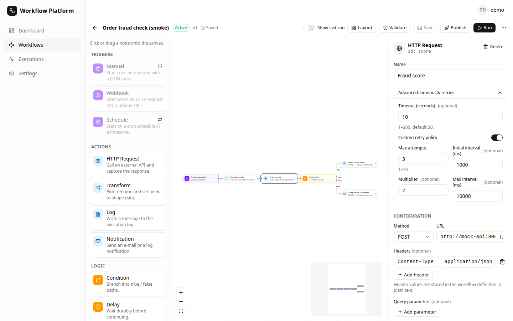
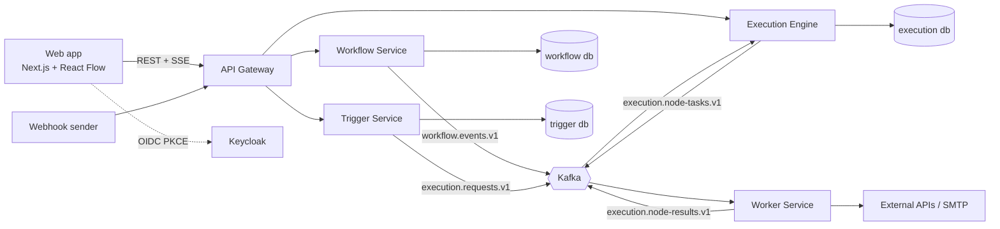

# Workflow Engine

[](https://openjdk.org/projects/jdk/21/)
[](https://spring.io/projects/spring-boot)
[](https://spring.io/projects/spring-cloud-gateway)
[](https://spring.io/projects/spring-security)
[](https://projectlombok.org)
[](https://spring.io/projects/spring-data-jpa)
[](https://hibernate.org/orm/)
[](https://flywaydb.org)
[](https://resilience4j.readme.io)
[](https://www.postgresql.org)
[](https://kafka.apache.org)
[](https://redis.io)
[](https://www.keycloak.org)
[](https://nodejs.org)
[](https://nextjs.org)
[](https://react.dev)
[](https://www.typescriptlang.org)
[](https://tailwindcss.com)
[](https://ui.shadcn.com)
[](https://reactflow.dev)
[](https://tanstack.com/query)
[](https://docs.docker.com/compose/)
[](https://helm.sh)
[](https://docs.github.com/actions)
[](https://opentelemetry.io)
[](https://prometheus.io)
[](https://grafana.com)
[](https://testcontainers.com)
[](https://vitest.dev)
[](https://playwright.dev)

A personal project: a small workflow automation platform in the spirit of n8n, with Temporal-style durable
execution underneath. You draw a workflow in the browser, publish it, and trigger it by hand, with a signed webhook,
or on a cron schedule. The steps run on separate workers through Kafka, and you can watch every step live.

I built it to get hands-on with the hard parts of distributed systems, not just talk about them: durable state
machines, the transactional outbox, idempotent consumers, task leases, crash recovery, and tracing a request across
services and Kafka. Everything runs locally with Docker Compose.



## What it can do

* **Visual editor.** Drag nodes from a palette, connect them, configure each node in a side panel. Conditions
  have `true` and `false` outputs. Auto-layout, validation with the broken nodes highlighted, version history,
  sharing with other users.
* **Nine node types.** Manual, Webhook and Schedule triggers; HTTP Request, Transform, Log, Notification (e-mail or
  log), Condition, and Delay (up to 7 days, survives restarts).
* **Passing data between steps.** `{{ trigger.body.orderId }}` or `{{ nodes.score.output.body.score }}` in any
  text field. These are plain property paths; no user code is ever executed.
* **Live monitoring.** The execution page updates over Server-Sent Events: graph colours, a timeline, and each
  node's input, output, attempts and errors. Reconnecting replays what you missed. Runs can be cancelled or retried.
* **Failure handling.** Retries with exponential back-off, timeouts, re-dispatch when a worker disappears,
  dead-letter topics, and protection against duplicate messages.
* **Observability.** JSON logs with trace and correlation ids, Prometheus metrics, Grafana dashboards, and Jaeger
  traces that follow one webhook through all services.

## How it's put together



| Part | What it does |
|---|---|
| `services/api-gateway` | Routing, token check, rate limiting, CORS, correlation ids |
| `services/workflow-service` | Drafts, validation, immutable published versions, sharing |
| `services/execution-engine` | The durable state machines, scheduling, retries, leases, timeouts, live updates |
| `services/worker-service` | Runs the nodes (HTTP with SSRF protection, condition, transform, log, notification) |
| `services/trigger-service` | Webhook endpoints (HMAC signatures, replay protection) and cron schedules |
| `apps/web` | The web app |
| `packages/contracts` | Shared event formats and JSON schemas |
| `packages/platform-support` | Outbox, duplicate detection, Kafka dead-lettering, error responses |

If you want the details: [architecture](docs/architecture/overview.md) (state machines, join rules, failure
scenarios), [why I chose what I chose](docs/design-decisions.md), [security](docs/architecture/security.md),
[REST API](docs/api/README.md), [events](docs/events/catalog.md).

## Screenshots

| Dashboard | Executions | Execution detail |
|---|---|---|
|  |  |  |

## Running it

You need Docker with Compose v2 and roughly 6 GB of free memory. The helper scripts also use `curl`, `jq`, `openssl`
and Python 3. To build outside Docker: JDK 21+ and Node 24+. The code targets Java 21; the
Docker images build with JDK 24 and run on Java 25 and Node 26.

```bash
docker compose up -d --build                    # first build takes a few minutes
docker compose --profile observability up -d    # optional: Jaeger, Prometheus, Grafana
scripts/smoke-test.sh                           # creates the demo workflow and runs it twice
```

| URL | What | Login |
|---|---|---|
| http://localhost:3000 | Web app | `demo`/`demo` (also `alice`, `bob`, and `admin` as admin; password = username) |
| http://localhost:8080 | API gateway | Bearer token |
| http://localhost:8180 | Keycloak | `admin`/`admin` |
| http://localhost:8025 | Mailpit, catches the notification e-mails | – |
| http://localhost:16686, :9090, :3001 | Jaeger, Prometheus, Grafana | Grafana `admin`/`admin` |
| http://localhost:8081-8084/swagger-ui.html | OpenAPI page of each service | – |

All passwords and keys in `compose.yaml` are local development values. The ones you might want to change:

| Variable | Default | Meaning |
|---|---|---|
| `TRIGGER_ENCRYPTION_KEY` | dev key | AES key for stored webhook secrets (`openssl rand -base64 32`) |
| `ENGINE_LEASE_GRACE` | `60s` | How long after a node's timeout the engine gives up on a worker and re-dispatches |
| `WORKER_HTTP_ALLOWED_HOSTS` | `mock-api` | Hosts allowed to resolve to private addresses |
| `EXECUTION_START_RATE` / `_BURST` | `5` / `20` | Manual starts per user per second |

## The demo workflow

`scripts/order-webhook-demo.json` is what `smoke-test.sh` uses. A signed webhook receives an order, a Transform node
shapes it, an HTTP Request asks a (mock) fraud API for a score, and a Condition sends high-risk orders to the fraud
team and confirms the rest to the customer by e-mail.

`scripts/demo-failure-recovery.sh` then breaks things on purpose: it kills a worker in the middle of an HTTP call,
kills the engine during a delay, and replays a Kafka message. All three runs still end correctly.
[docs/demo-guide.md](docs/demo-guide.md) walks through both, with the results I got.

## Tests

```bash
./mvnw verify -DskipITs          # unit, architecture and contract tests (no Docker needed)
./mvnw verify                    # plus integration tests against real PostgreSQL, Kafka and Redis (Testcontainers)
cd apps/web && npm ci && npm run lint && npm run typecheck && npm test
cd apps/web && npx playwright install chromium && npm run test:e2e   # needs the Compose stack running
scripts/load-test.py 200 20      # throughput and latency, results in docs/performance.md
```

Last full run: 253 backend tests, 78 frontend unit tests and 2 Playwright journeys, all passing, both on Docker
Compose and on a local kind cluster.

## Kubernetes and CI

I also wrote a Helm chart (`infrastructure/helm/workflow-platform`) and tested it on a local kind cluster; the steps
are in [docs/runbooks/kubernetes.md](docs/runbooks/kubernetes.md). GitHub Actions builds and tests everything on each
push (`.github/workflows/ci.yml`) and publishes images to GHCR from `main` (`release.yml`).

## Limitations

* Messages are delivered at least once. State changes are safe, but if a worker crashes mid-call an HTTP request can
  be sent twice. HTTP nodes send an `Idempotency-Key` header for APIs that support it.
* Only acyclic graphs, and one trigger per workflow.
* Right after publishing, starting a run can return `409 version-not-available` for a moment; the UI retries.
* No credential store: an API key typed into an HTTP header is saved as part of the workflow.
* Cancelling doesn't interrupt a step that is already running on a worker; its result is just ignored.
* Single Kafka broker and single PostgreSQL. It runs on my laptop, not in production.

## When something goes wrong

* **A container isn't healthy after `up`:** check `docker compose logs <service>`. Usually Keycloak or Kafka were
  still starting; run `docker compose up -d` again.
* **Login loops or 401 everywhere:** open the app on `localhost:3000`, not `127.0.0.1`. Tokens must come from
  `localhost:8180`.
* **HTTP node fails with `DESTINATION_BLOCKED`:** the URL points to a private address. Only hosts in
  `WORKER_HTTP_ALLOWED_HOSTS` may do that.
* **Port already in use:** the stack uses 3000, 5432, 6379, 8025, 8080-8084, 8089, 8180 and 9094.

More in [docs/runbooks/operations.md](docs/runbooks/operations.md).
