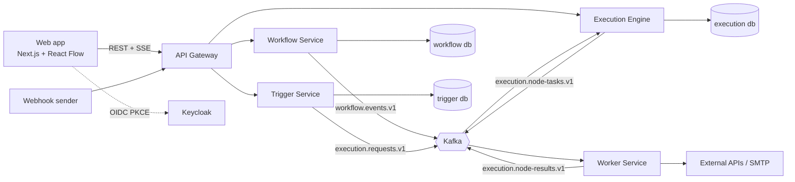
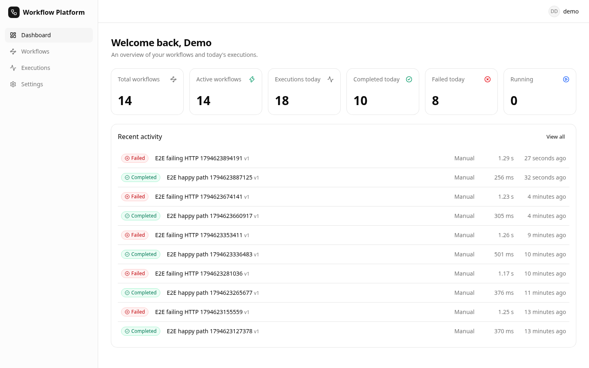
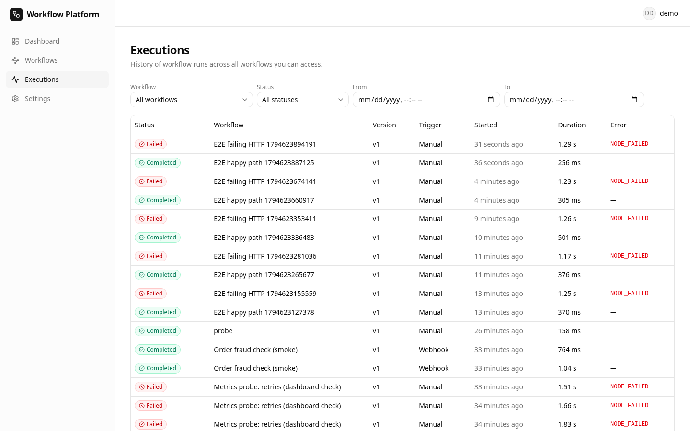

# Workflow Automation Platform

[](https://openjdk.org/projects/jdk/21/)
[](https://spring.io/projects/spring-boot)
[](https://spring.io/projects/spring-cloud-gateway)
[](https://spring.io/projects/spring-security)
[](https://hibernate.org/orm/)
[](https://flywaydb.org)
[](https://resilience4j.readme.io)
[](https://www.postgresql.org)
[](https://kafka.apache.org)
[](https://redis.io)
[](https://www.keycloak.org)
[](https://nextjs.org)
[](https://react.dev)
[](https://www.typescriptlang.org)
[](https://tailwindcss.com)
[](https://ui.shadcn.com)
[](https://reactflow.dev)
[](https://tanstack.com/query)
[](https://docs.docker.com/compose/)
[](https://helm.sh)
[](https://docs.github.com/actions)
[](https://opentelemetry.io)
[](https://prometheus.io)
[](https://grafana.com)
[](https://testcontainers.com)
[](https://playwright.dev)

A distributed workflow automation system: design workflows visually, publish immutable versions, trigger them
manually, by signed webhook or on a cron schedule, and watch them run on distributed workers with durable state,
retries, timeouts and crash recovery.


## Architecture



| Service | Responsibility |
|---|---|
| `services/api-gateway` | Spring Cloud Gateway: routing, JWT pre-validation, Redis rate limiting, CORS, correlation ids |
| `services/workflow-service` | Drafts, JSON-schema + graph validation, immutable versions, sharing (OWNER/EDITOR/VIEWER) |
| `services/execution-engine` | Durable execution and node state machines, DAG scheduling, retries, leases, timeouts, cancellation, SSE |
| `services/worker-service` | Node handlers (HTTP Request with SSRF protection, Condition, Transform, Log, Notification) |
| `services/trigger-service` | Webhook endpoints (token + HMAC + replay protection), cron schedules, trigger deliveries |
| `apps/web` | Dashboard, workflow list, visual editor, live execution monitoring, history, settings |
| `packages/contracts` | Event envelope, event payload records, versioned JSON schemas (+ contract tests) |
| `packages/platform-support` | Transactional outbox, idempotent consumer store, Kafka DLT handling, correlation ids, Problem Details |

Details: [architecture overview](docs/architecture/overview.md) (C4 context/containers, state machines, join
semantics, reliability, failure scenarios, limits), [engine components](docs/architecture/execution-engine-components.md),
[security model](docs/architecture/security.md), [event catalog](docs/events/catalog.md), [REST API](docs/api/README.md),
[ADRs](docs/adr/README.md).

## Technology

Java 21, Spring Boot 3.5, Spring Security (OAuth2 resource server), Spring Data JPA/Hibernate, Flyway, Spring Kafka,
Spring Cloud Gateway 2025.0, Resilience4j, Micrometer + OpenTelemetry, PostgreSQL 17, Apache Kafka 4.1 (KRaft),
Redis 7, Keycloak 26. Next.js 16, React 19, TypeScript (strict), Tailwind, shadcn/ui, React Flow 12, TanStack Query,
Zustand, React Hook Form + Zod. Docker Compose, Helm, GitHub Actions, Prometheus, Grafana, OTel Collector, Jaeger.
Tests: JUnit 5, AssertJ, Mockito, Testcontainers, ArchUnit, Vitest, React Testing Library, Playwright.

## Features

* Visual editor: drag-and-drop or click-to-add palette, typed node forms, condition branches (`true`/`false`
  handles), auto layout, validation with node highlighting, versions, sharing, trigger settings, last-run overlay.
* Nine node types: Manual / Webhook / Schedule triggers, HTTP Request, Transform, Log, Notification (e-mail or log),
  Condition, Delay (durable timer, up to 7 days).
* Templates `{{ trigger.body.x }}`, `{{ nodes.<id>.output.<path> }}` resolved by the engine; no code execution.
* Execution monitoring: live graph, timeline and node details (inputs, outputs, attempts, errors) over SSE with
  reconnect/replay from persisted history; cancel and retry.
* Reliability: transactional outbox, idempotent consumers, attempt fencing, task leases, exponential back-off retries,
  dead-letter topics, optimistic locking, execution timeouts, per-workflow concurrency limits.
* Observability: JSON (ECS) logs with trace and correlation ids, Prometheus metrics, traces across HTTP and Kafka,
  provisioned Grafana dashboards.

## Screenshots

| Dashboard | Executions | Execution detail |
|---|---|---|
|  |  |  |

## Getting started

Requirements: Docker with Compose v2 (about 6 GB free memory). For the scripts: `curl`, `jq`, `openssl`, Python 3.
For building outside Docker: JDK 21 and Node 20.

```bash
docker compose up -d --build                    # whole platform (first build takes a few minutes)
docker compose --profile observability up -d    # optional: Jaeger, Prometheus, Grafana
scripts/smoke-test.sh                           # end-to-end check of the demo workflow
```

| URL | What | Login |
|---|---|---|
| http://localhost:3000 | Web app | `demo`/`demo`, `alice`/`alice`, `bob`/`bob`, `admin`/`admin` (ADMIN) |
| http://localhost:8080 | API gateway | Bearer token |
| http://localhost:8180 | Keycloak | admin console `admin`/`admin` |
| http://localhost:8025 | Mailpit (notification e-mails) | – |
| http://localhost:16686 / :9090 / :3001 | Jaeger / Prometheus / Grafana | Grafana `admin`/`admin` |
| http://localhost:8081-8084/swagger-ui.html | OpenAPI of each service | – |

### Configuration

Defaults are development values set in `compose.yaml`. Relevant overrides (environment variables):

| Variable | Default | Meaning |
|---|---|---|
| `TRIGGER_ENCRYPTION_KEY` | dev-only key | Base64 32-byte AES key for webhook tokens/secrets (`openssl rand -base64 32`) |
| `ENGINE_LEASE_GRACE` | `60s` | Time after a node timeout before an unanswered task is re-dispatched |
| `WORKER_HTTP_ALLOWED_HOSTS` | `mock-api` | Hosts trusted to resolve to private addresses (administrator setting) |
| `EXECUTION_START_RATE` / `_BURST` | `5` / `20` | Manual starts per user and second at the gateway |
| `POSTGRES_PASSWORD`, `KEYCLOAK_ADMIN_PASSWORD`, `GRAFANA_ADMIN_PASSWORD` | dev values | – |

Services read `DB_URL`, `KAFKA_BOOTSTRAP`, `OIDC_ISSUER`, `OIDC_JWKS_URI`, `OTLP_TRACES_ENDPOINT` and others; see each
`services/*/src/main/resources/application.yml`.

## Example workflow

`scripts/order-webhook-demo.json`: a signed webhook receives an order; Transform shapes it; HTTP Request calls a fraud
API; Condition checks `score > 70`; the `true` branch e-mails the fraud team, the `false` branch confirms to the
customer. Walkthrough and failure demonstrations (worker crash, engine crash, duplicate events) with recorded results:
[docs/demo-guide.md](docs/demo-guide.md).

## Tests

```bash
./mvnw verify -DskipITs          # unit + ArchUnit + contract tests (no Docker needed)
./mvnw verify                    # + integration tests with Testcontainers (PostgreSQL, Kafka, Redis)
cd apps/web && npm ci && npm run lint && npm run typecheck && npm test
cd apps/web && npx playwright install chromium && npm run test:e2e   # needs the compose stack and web on :3000
scripts/demo-failure-recovery.sh # crash and duplicate-message scenarios against the running stack
scripts/load-test.py 200 20      # throughput/latency measurement (see docs/performance.md)
```

Last full run: 253 backend tests (unit, ArchUnit, contract, Testcontainers integration), 78 frontend unit tests and
2 Playwright journeys passed, against Docker Compose and against a kind cluster deployed with the Helm chart. Measured performance: [docs/performance.md](docs/performance.md).

## Deployment

* Kubernetes: Helm chart `infrastructure/helm/workflow-platform` (+ `values-kind.yaml`) and development dependencies in
  `infrastructure/kubernetes/dev-dependencies`; step-by-step guide for kind in
  [docs/runbooks/kubernetes.md](docs/runbooks/kubernetes.md).
* CI/CD: `.github/workflows/ci.yml` (format check, build, unit/architecture tests, integration tests, frontend lint/
  types/tests/build, Trivy and dependency review, Helm lint + kubeconform, image builds) and `release.yml`
  (tests, then image publication to GHCR with SBOM/provenance, then an optional Helm deploy to `staging`).

## Guarantees and limitations

* Execution state transitions are applied at most once per node attempt; message delivery is at least once. Node
  handlers may run more than once after crashes, so external side effects can repeat; HTTP Request nodes send an
  `Idempotency-Key` header (`<executionId>:<nodeId>`) that cooperating APIs can use.
* Only DAGs (no loops). One trigger per workflow.
* Projections are eventually consistent: immediately after publishing, starting a run can return `409
  version-not-available` for a moment (the UI retries).
* No credential store yet (header values live in the definition); no mTLS between services; single-broker Kafka and
  single PostgreSQL in development.
* Operational procedures: [docs/runbooks/operations.md](docs/runbooks/operations.md).

## Troubleshooting

* **A service is unhealthy after `up`**: `docker compose logs <service>`; most often Keycloak or Kafka were still
  starting, run `docker compose up -d` again.
* **Login loops or 401 everywhere**: tokens must be issued by `http://localhost:8180`; open the app on
  `localhost:3000` (not `127.0.0.1`).
* **`409 version-not-available` when running right after publishing**: wait a second and retry.
* **HTTP node fails with `DESTINATION_BLOCKED`**: the URL resolves to a private address; only hosts in
  `WORKER_HTTP_ALLOWED_HOSTS` may do that.
* **Port already in use**: the stack binds 3000, 5432, 6379, 8025, 8080-8084, 8089, 8180, 9094.
