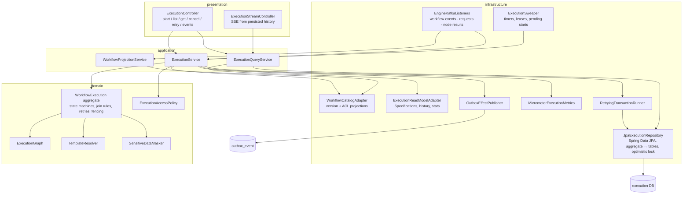

# Execution Engine Components (C4 level 3)

One operation = one transaction: load aggregate (`OPTIMISTIC_FORCE_INCREMENT`), call one domain method with `now`,
persist changed rows, append history entries, write outbox effects. Conflicts are retried up to five times.

Persistence uses Spring Data JPA repositories with Lombok entities. SQL remains only where it is the correct tool:
the sweeper's due-timer UNION over partial indexes, the JDBC batch insert of history rows, the dashboard
`count(*) FILTER` aggregate, and the projection upserts (`INSERT ... ON CONFLICT ... WHERE revision < excluded`)
that must be atomic under concurrent consumers.
