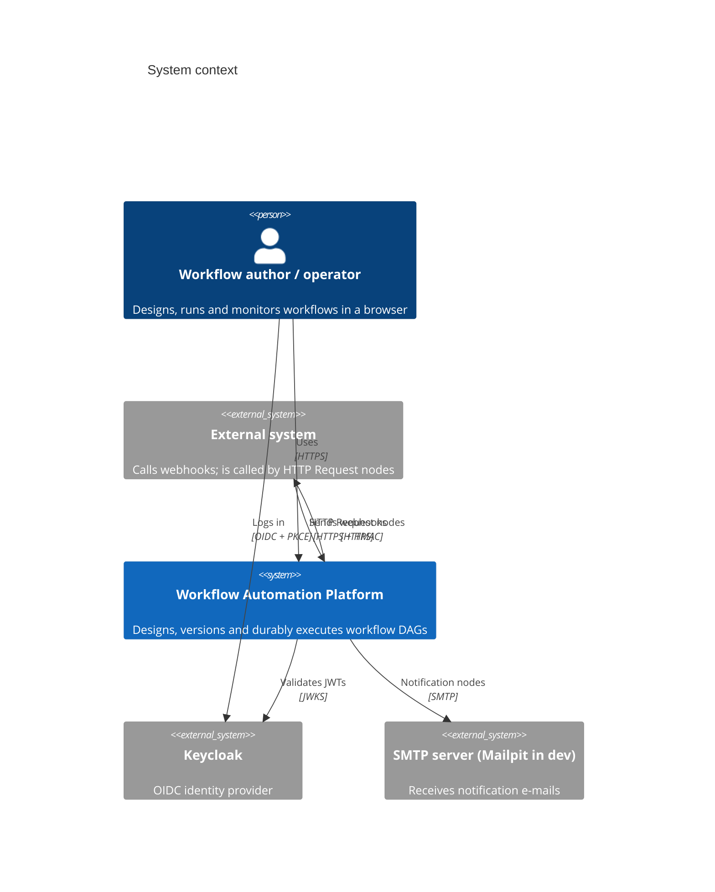
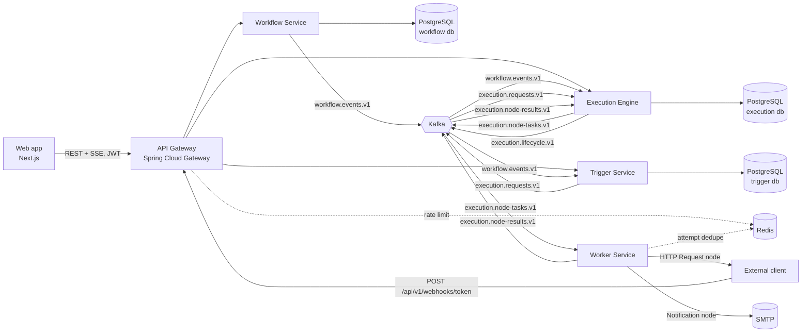
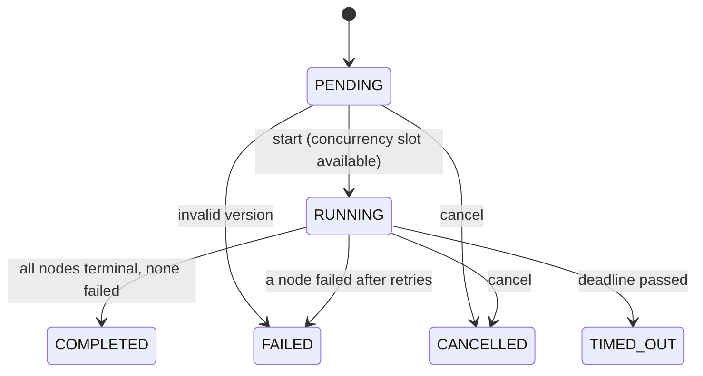
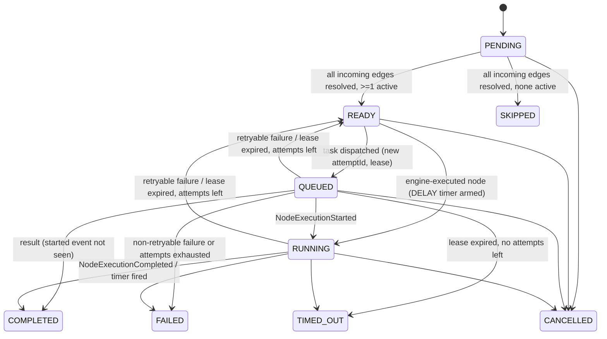

# Architecture Overview

This document is the reference for service boundaries, the execution model, contracts and failure handling.
Decisions and their trade-offs are recorded in [`docs/adr`](../adr).

## 1. System context (C4 level 1)



## 2. Containers (C4 level 2)



| Container | Owns | Talks to |
|---|---|---|
| **api-gateway** (8080) | Routing, JWT pre-validation, rate limiting (Redis), CORS, correlation ID | All HTTP services |
| **workflow-service** (8081) | Workflow drafts, immutable versions, permissions, graph validation | Postgres `workflow`, Kafka (produces `workflow.events.v1` via outbox) |
| **execution-engine** (8082) | Executions, node state machines, scheduling, retries, leases, timeouts, SSE | Postgres `execution`, Kafka (consumes workflow events, requests, node results; produces tasks + lifecycle via outbox) |
| **worker-service** (8083) | Stateless node handlers (HTTP, Condition, Transform, Log, Notification) | Kafka, Redis (attempt dedupe), external HTTP, SMTP |
| **trigger-service** (8084) | Webhook and cron trigger registrations, trigger deliveries | Postgres `trigger`, Kafka (consumes workflow events, produces execution requests via outbox) |
| **web** (3000) | Visual editor, monitoring UI | Gateway, Keycloak |

No service reads another service's database. Cross-service data is obtained from events (event-carried state transfer, see ADR-0010).

## 3. Bounded contexts

* **Workflow Definition** (workflow-service): authoring. Aggregate `Workflow` (draft + metadata + permissions) and immutable `WorkflowVersion`.
* **Execution** (execution-engine): runtime. Aggregate `WorkflowExecution` containing its `NodeExecution`s. Holds read-only projections of published versions and workflow ACLs.
* **Task Execution** (worker-service): side-effecting work. No persistent state other than a short-lived attempt cache.
* **Triggering** (trigger-service): turning external stimuli (webhooks, time) into execution requests. Holds projections of published trigger configuration and ACLs.
* **Identity** (Keycloak): users, realm roles `ADMIN`, `USER`.

Manual execution is a user command, so it is served by the execution engine directly (`POST /api/v1/workflows/{id}/executions`) rather than relayed through the trigger service. See ADR-0011.

## 4. Workflow definition model (schema version 1)

JSON Schema: [`packages/contracts/src/main/resources/schemas/workflow-definition.v1.json`](../../packages/contracts/src/main/resources/schemas/workflow-definition.v1.json).

```json
{
  "schemaVersion": 1,
  "nodes": [
    { "id": "webhook", "type": "WEBHOOK_TRIGGER", "name": "Order webhook", "position": {"x": 0, "y": 0},
      "config": { "requireSignature": true, "requiredFields": ["orderId"] } },
    { "id": "check", "type": "CONDITION", "name": "Big order?",
      "config": { "combinator": "AND", "conditions": [
        { "left": "{{ trigger.body.amount }}", "operator": "GREATER_THAN", "right": 100 } ] } }
  ],
  "edges": [ { "id": "e1", "source": "webhook", "target": "check" } ],
  "settings": { "executionTimeoutSeconds": 3600, "maxConcurrentExecutions": 10 }
}
```

Node-level optional fields: `timeoutSeconds` (1..300, default 30) and
`retryPolicy` `{maxAttempts 1..10, initialIntervalMs, multiplier, maxIntervalMs}` (default 3 attempts, 1s, x2, 60s).

| Type | Category | Executed by | Output | Branch handles |
|---|---|---|---|---|
| `MANUAL_TRIGGER` | trigger | engine (start) | request input | – |
| `WEBHOOK_TRIGGER` | trigger | engine (start) | `{body, headers, query, receivedAt}` | – |
| `SCHEDULE_TRIGGER` | trigger | engine (start) | `{scheduledAt, firedAt, payload}` | – |
| `HTTP_REQUEST` | action | worker | `{status, headers, body}` | – |
| `CONDITION` | logic | worker | `{result}` | `true`, `false` |
| `TRANSFORM` | action | worker | constructed object | – |
| `LOG` | action | worker | `{level, message}` | – |
| `NOTIFICATION` | action | worker | `{channel, recipient, deliveredAt}` | – |
| `DELAY` | logic | engine (durable timer) | `{delayedSeconds, resumedAt}` | – |

### Templates (restricted mapping language)

String values in a node `config` may contain `{{ path }}` placeholders, resolved by the engine immediately before the
node is dispatched. A path is a dotted/indexed property path; no operators, function calls or code:

* `trigger.<path>` – output of the trigger node
* `nodes.<nodeId>.output.<path>` – output of a completed upstream node
* `execution.id`, `execution.workflowId`, `execution.workflowVersion`

If a string is exactly one placeholder, the referenced JSON value is substituted with its type preserved; otherwise the
values are interpolated as text. Missing paths resolve to `null` (or empty text). Publication fails if a template
references a node that is not an ancestor of the node using it.

## 5. Execution model

### 5.1 Execution state machine



### 5.2 Node state machine



Allowed transitions are defined in `NodeStatus`/`ExecutionStatus` and every edge (and every forbidden pair) is unit tested.
When a workflow fails, is cancelled or times out, every non-terminal node becomes `CANCELLED`
(or `TIMED_OUT` for active nodes on execution timeout).

### 5.3 Scheduling and join semantics

* The trigger node completes at start with the trigger payload as its output.
* When a node reaches a terminal state, only its **direct successors** are evaluated (incremental scheduling).
* An incoming edge is *resolved* when its source is terminal. It is *active* when the source is `COMPLETED` and the
  edge has no `sourceHandle` or its `sourceHandle` equals the branch selected by the source (CONDITION: `true`/`false`).
* A `PENDING` node becomes `READY` when **all incoming edges are resolved and at least one is active**.
  If all are resolved and none is active, it becomes `SKIPPED`, which propagates to its successors.
  This lets a node placed after a condition's two branches run when one branch completed and the other was skipped.
* A `READY` node with `availableAt <= now` is dispatched in the same transaction that made it ready.
* An execution is `COMPLETED` when all nodes are terminal and none failed. Output = outputs of completed sink nodes.

### 5.4 Attempts, leases and fencing

Each dispatch creates a new `attemptId` (UUID) and records a lease (`leaseExpiresAt = now + timeout + grace`).
Worker results carry the `attemptId`; the engine ignores results whose attempt is not the node's current attempt or whose
node is no longer active (fencing). `NodeExecutionStarted` extends the lease. A sweeper treats an expired lease as a
retryable failure (`TASK_LEASE_EXPIRED`) that consumes one attempt.

Business retries (node `retryPolicy`, exponential backoff, only for retryable errors) are separate from technical
delivery retries (Kafka consumer back-off + dead-letter topic, see section 7).

### 5.5 Timers

A single sweeper (`ExecutionSweeper`, every second) finds executions with due work using indexed queries:
READY nodes whose `availableAt` passed (retry back-off), DELAY nodes whose `resumeAt` passed, active nodes whose lease
expired, RUNNING executions whose deadline passed, and PENDING executions waiting for a concurrency slot.
It calls `WorkflowExecution.advance(now)` for each. Because the timers are columns in PostgreSQL, they survive restarts.

### 5.6 Concurrency control

`WorkflowExecution` is the consistency boundary. Each mutation loads it with `OPTIMISTIC_FORCE_INCREMENT`,
so two transactions that change different nodes of the same execution still conflict on the root version.
The losing transaction is retried (up to 5 times). Kafka keys all task/result messages by `executionId`, so results of
one execution are normally processed sequentially; the optimistic lock protects against API calls (cancel) and sweepers
running concurrently on other replicas. Concurrent-execution limits per workflow are enforced under a row lock on the
workflow projection.

## 6. Events and topics

See [`docs/events/catalog.md`](../events/catalog.md). Envelope:

```json
{ "eventId": "uuid", "eventType": "NodeExecutionCompleted", "eventVersion": 1, "aggregateId": "<executionId>",
  "correlationId": "uuid", "causationId": "uuid|null", "occurredAt": "2025-01-01T00:00:00Z", "payload": { } }
```

Topic naming: `<context>.<stream>.v<major>`; dead letters `<topic>.dlt`.

## 7. Reliability

| Mechanism | Where | Notes |
|---|---|---|
| Transactional outbox | workflow, engine, trigger | Outbox row written in the business transaction; a polling publisher holding a PostgreSQL advisory lock publishes in id order, marks rows published after broker ack. Trace context is stored with the row. |
| Idempotent consumer | engine, trigger | `processed_message(consumer, event_id)` inserted in the same transaction as the state change. |
| Fencing | engine | `attemptId` + node status checks reject stale results. |
| Attempt cache | worker | Redis `attempt:<id>` stores the result of a finished attempt; redelivered tasks re-publish the cached result instead of re-running side effects. A crash mid-handler re-runs the handler (at-least-once). |
| Delivery retries / DLT | all consumers | `DefaultErrorHandler` with exponential back-off; deserialization/validation errors go straight to `<topic>.dlt`. |
| Recovery | engine | Sweeper reconciles leases, timers and pending executions on every replica; no in-memory state is required to resume. |

**Guarantees:** state transitions are applied at most once per (execution, node, attempt). Node handlers run at least once
per attempt; external side effects can be duplicated. HTTP Request nodes send an `Idempotency-Key: <executionId>:<nodeId>`
header so cooperating APIs can deduplicate. Exactly-once side effects are not claimed.

## 8. Failure scenarios

| Scenario | Behaviour |
|---|---|
| Worker crashes mid-task | Offset not committed → task redelivered after rebalance/restart; same attemptId; handler re-runs. If down longer than the lease, the engine starts a new attempt and the old one is fenced. |
| Worker publishes result, crashes before offset commit | Task redelivered; Redis attempt cache returns the stored result; engine dedupes the duplicate result by eventId/attempt. |
| Engine crashes after commit, before publish | Outbox row remains unpublished; publisher on any replica sends it. |
| Engine crashes before commit | Consumer offset not committed; message redelivered; transaction replays. |
| Duplicate Kafka message | `processed_message` unique key → ignored. |
| Broker unavailable | Outbox rows accumulate; publisher retries; HTTP APIs keep accepting writes. |
| Database unavailable | Consumers fail, back off, eventually DLT; health check reports DOWN. |
| Execution requested before the version projection arrived | Consumer throws a retryable error; back-off retries until the projection exists. |
| Cancel races with a completion | Root version conflict; loser retries and sees the terminal execution; stale result ignored. |

## 9. Limits (defaults, configurable)

| Limit | Value |
|---|---|
| Nodes per workflow | 100 (edges 200) |
| Definition size | 512 KiB |
| Webhook / execution input payload | 256 KiB |
| Node output stored | 256 KiB |
| HTTP response body read | 1 MiB |
| Node timeout | 1–300 s |
| Execution timeout | 1 s – 24 h |
| Retry attempts | 1–10 |
| Concurrent executions per workflow | 1–50 (default 10, excess wait in PENDING) |

## 10. Security model

See [`docs/architecture/security.md`](security.md).
