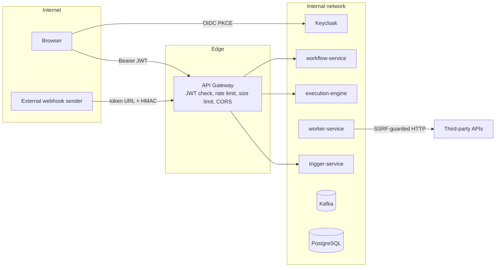

# Security Model

## Trust boundaries

| Boundary | Threat | Control |
|---|---|---|
| Browser → gateway | Forged/expired tokens, CSRF, cross-origin abuse | Keycloak OIDC with PKCE; JWT signature, issuer, audience `workflow-api` and expiry checked at the gateway **and again in every service**; stateless bearer auth (no cookies, so no CSRF surface); CORS limited to the configured origin |
| Gateway → services | Bypassing the gateway | Services validate JWTs themselves and apply resource-level authorization; the gateway is not trusted for authorization |
| Webhook sender → trigger service | Guessing, replay, flooding | 256-bit random token in the URL (stored as SHA-256 hash plus AES-GCM ciphertext); optional HMAC-SHA256 signature over `timestamp.body` with ±5 min window; deduplication by delivery id or signature; per-IP rate limit and 256 KiB limit at the gateway |
| Workflow definition → engine/worker | Code injection | No user code is executed: templates are property paths only, conditions use a fixed set of typed operators, transforms are pick/rename/set. JSON schema with `additionalProperties: false` |
| Worker → network | SSRF to internal services or cloud metadata | Only http/https; credentials in URLs rejected; DNS resolution through a guard that rejects loopback, private, link-local (169.254.169.254), CGNAT, ULA, multicast and IPv4-mapped forms; every redirect hop re-validated (max 5); no proxies, no cookies; only administrator-configured hosts (`WORKER_HTTP_ALLOWED_HOSTS`) may resolve privately |
| Worker → third party | Resource exhaustion | Response body limit 1 MiB, node timeout ≤ 300 s, per-host circuit breaker |
| Data at rest | Secret disclosure | Webhook token and signing secret encrypted with AES-256-GCM using `TRIGGER_ENCRYPTION_KEY` from the environment (never from Git or the DB) |
| Logs, events, history | Secret leakage | History entries never contain inputs or outputs; HTTP adapter logs only method, host, status and duration; webhook secrets never enter Kafka; API responses mask values of sensitive-looking keys |

## Authorization

Realm roles `USER` and `ADMIN` (admins can access every workflow). Per workflow: `OWNER` > `EDITOR` > `VIEWER`.

| Action | Minimum role |
|---|---|
| View workflow, versions, executions, trigger status | VIEWER |
| Edit draft, validate, publish, run, cancel, retry, rotate webhook secret, see webhook URL | EDITOR |
| Share, archive | OWNER |

The workflow service is authoritative; the engine and the trigger service apply the same rules to their ACL
projections. Resources the caller cannot see return 404, not 403, to avoid revealing their existence.
Workspace-level permissions can be added later by introducing principal types (user, group) in the ACL entries
without changing the role semantics.

## Limits

See [overview § 9](overview.md#9-limits-defaults-configurable). Request bodies are limited both at the gateway
(`RequestSize`) and in each service (`RequestSizeLimitFilter`).

## Known gaps

* No credential store yet: values typed into HTTP headers (for example API keys) are part of the workflow definition,
  stored unencrypted in the workflow database and present in task messages. API responses mask them.
* Service-to-service traffic inside the cluster is not mutually authenticated (no mTLS); Kafka has no ACLs in the
  development setup.
* Dev Keycloak runs `start-dev` over HTTP with demo users; the `workflow-cli` password-grant client is for local
  scripts only and must be removed in production.
* Audit logging is limited to the persisted execution history and structured application logs (who published, who
  ran, who cancelled is recorded in `published_by`, `triggered_by` and cancellation history entries).
